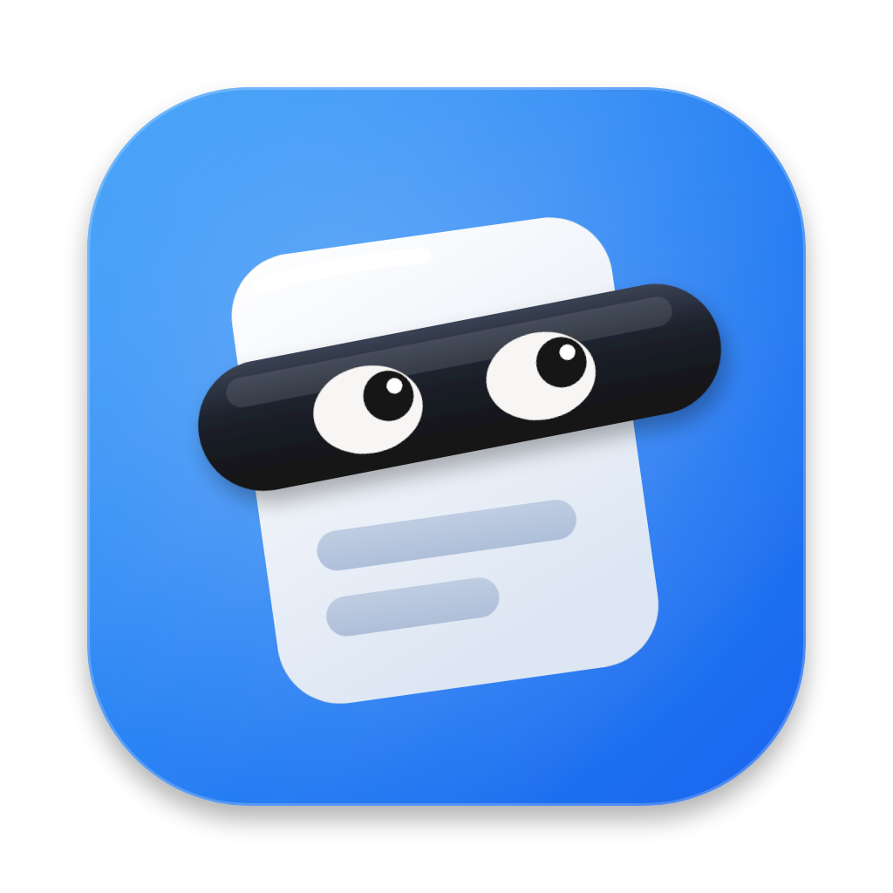
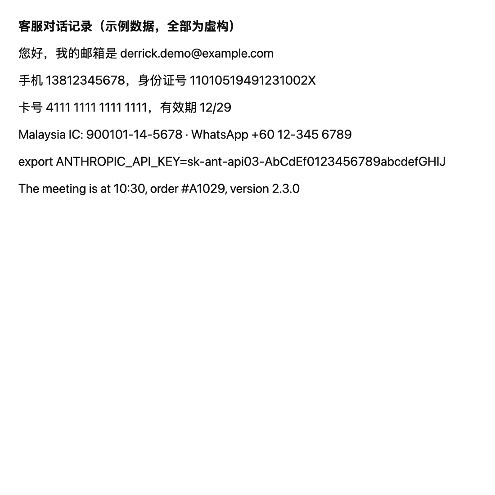
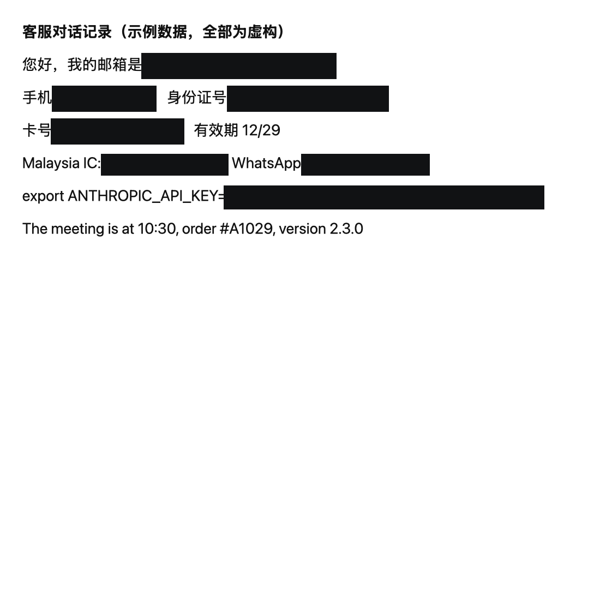
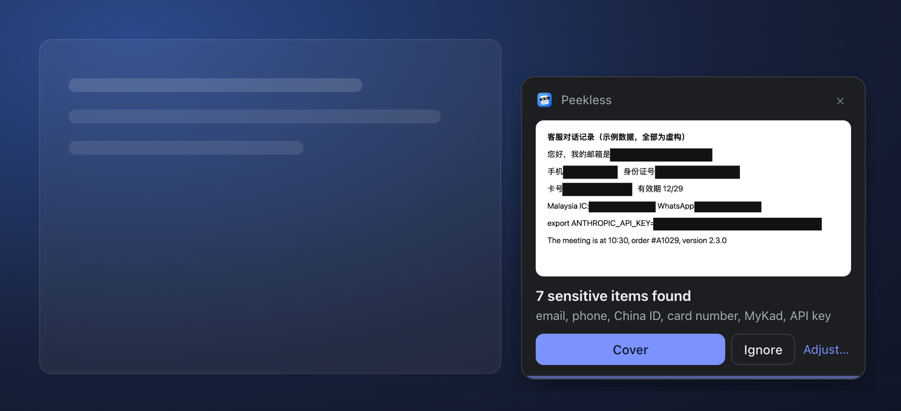
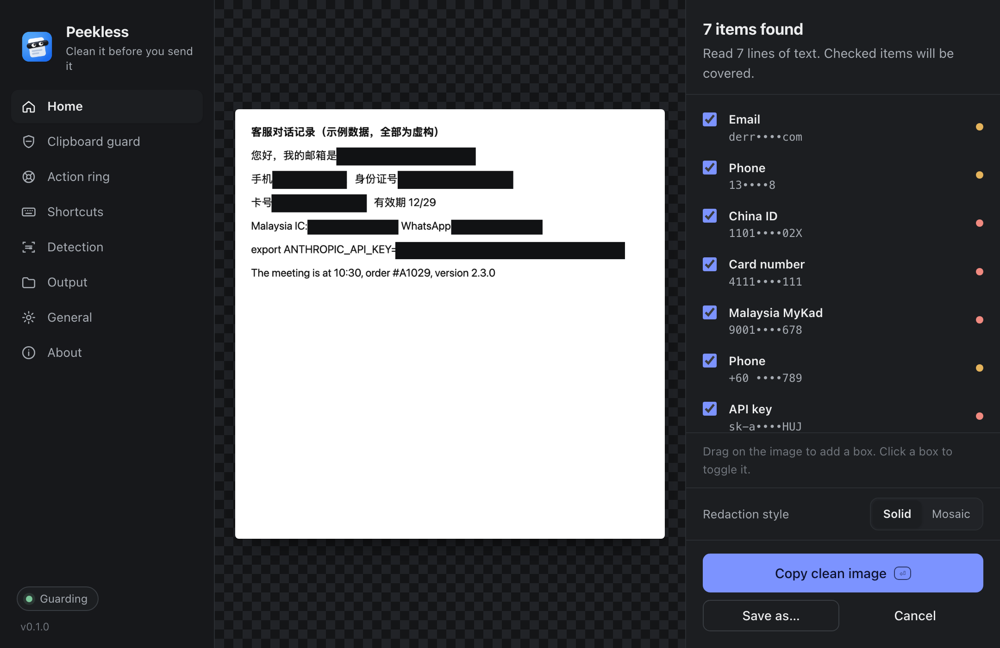
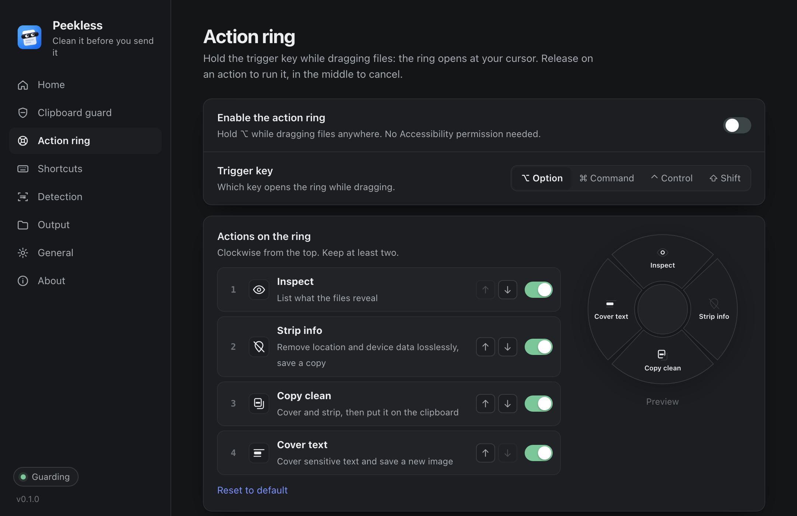

<p align="center">
  
</p>

<h1 align="center">Peekless</h1>

<p align="center"><i>Peek·less: "no peeking". 中文名：遮遮</i></p>

<p align="center"><b>Clean it before you send it.</b><br>
Hide emails, phone numbers, ID and card numbers and API keys in screenshots and text, and strip hidden location data from photos. Offline, on your own computer, for macOS and Windows.</p>

<p align="center"><a href="#中文说明">中文说明</a></p>

| Before | After one shortcut |
|---|---|
|  |  |

*Sample data, all fictional. The right image is the real output of `peekless redact docs/before.png`.*



## Why

Every day we paste screenshots into chats, tickets and AI assistants. Each one can carry an email address, a phone number, an order with a card number, or the API key that was sitting in your terminal. Photos are worse: most phones write the exact GPS location into every picture.

The usual fixes are to crop by hand, open an image editor, or upload the file to a website that promises to strip metadata. Peekless does it in one keystroke, and nothing leaves your machine.

## What it does

- **Guard the clipboard, hands-free.** Take a screenshot or copy text as usual. If it contains something sensitive, a small card appears in the corner showing the covered version: click **Cover** and paste. Nothing sensitive, nothing happens. Prefer zero clicks? Switch to *Cover right away* and keep an **Undo** instead. Entries that password managers mark as concealed are never read.
- **Or do it on demand.** Press <kbd>⌘ ⌥ R</kbd> (<kbd>Ctrl Alt R</kbd> on Windows) to review the clipboard in full: toggle each box, drag to add your own, press <kbd>Enter</kbd>.
- **Clean copied text too.** Copied a log, a `.env` or a stack trace? Secrets become `[REDACTED:api_key]` before you paste them anywhere.
- **Hold ⌥ while dragging (macOS).** Drag photos from Finder, the desktop or anywhere, press ⌥, and an action ring opens under the cursor: *Inspect*, *Strip info*, *Copy clean* (redacted and metadata-free, straight to the clipboard) and *Cover text*. Release in the middle to cancel. No Accessibility permission needed.
- **Strip photo metadata.** Drop photos into the window to see what they reveal (location, device, date, author, AI-image prompts) and save clean copies. JPEG and PNG are cleaned losslessly: the image data is copied byte for byte and only the metadata is removed.
- **Make it yours.** Record your own shortcut, pick the ring's trigger key (⌥ ⌘ ⌃ ⇧) and which actions sit on it in what order, switch each detection type on or off, choose solid or mosaic, set where cleaned files go and how they are named, and choose language, theme and open-at-login. A *Try it* button drops a fictional sample screenshot on the clipboard so you can see the guard work.
- **Always review.** You confirm every redaction, can click to undo a box, and can drag to cover anything by hand.

| Review before you copy | Make the ring yours |
|---|---|
|  |  |

### What it catches

| Credentials | IDs and money | Contact | Photos |
|---|---|---|---|
| OpenAI, Anthropic, GitHub, AWS, Google, Stripe, Slack, Hugging Face and GitLab keys; JWTs; private keys; `password=` / `token:` values; secrets in URLs and connection strings | Card numbers (Luhn-checked), IBAN (mod-97), China resident ID (check digit), Malaysia MyKad, Singapore NRIC/FIN, Hong Kong ID, crypto wallets | Emails; phone numbers (China, Malaysia, international, North American); IP addresses | GPS location, camera and lens, date taken, serial numbers, author, XMP/IPTC, PNG text chunks (where AI image tools store prompts), C2PA |

Every pattern that has a checksum is validated, so order numbers and timestamps are left alone. See [`detect.rs`](src-tauri/src/detect.rs) for the rules and their tests.

## How it works

- **Text recognition** uses the engine your OS already ships: Apple Vision on macOS, `Windows.Media.Ocr` on Windows. No model download, no network. On macOS the screenshot never touches the disk.
- **Detection** is plain Rust: regular expressions plus validators, with unit tests for both the hits and the things that must *not* match.
- **Redaction** burns opaque bars into the pixels. A mosaic style exists, but solid bars are the default, because pixelated text can sometimes be reconstructed.
- **The app** is [Tauri 2](https://tauri.app). The installer is a few megabytes, and the UI has no framework and no build step.

## Install

Download the latest installer from [Releases](../../releases).

- **macOS 13+:** download `_aarch64.dmg` for Apple silicon or `_x64.dmg` for Intel, open it and drag Peekless to Applications. The app is not notarized yet, so the first launch is blocked once: open **System Settings → Privacy & Security**, scroll down and click **Open Anyway** next to Peekless. After that it opens normally and lives in the menu bar.
  If you prefer the terminal: `xattr -dr com.apple.quarantine /Applications/Peekless.app`
- **Windows 10/11:** run the `.msi` or `-setup.exe`. If SmartScreen appears, click **More info → Run anyway**. For Chinese text recognition, install the Chinese language pack in Windows settings.

## Command line

The app binary is also a CLI:

```bash
peekless text notes.txt              # print with secrets replaced
pbpaste | peekless text | pbcopy     # clean copied text
peekless scan screenshot.png         # what would be hidden (JSON)
peekless redact screenshot.png       # writes screenshot.redacted.png
peekless inspect IMG_0001.JPG        # what this photo reveals
peekless clean ~/Pictures/*.jpg      # writes *.clean.jpg, originals untouched
peekless clipboard                   # clean the clipboard in place, no window
```

On macOS the binary is at `/Applications/Peekless.app/Contents/MacOS/peekless`. `peekless clipboard` is handy to bind in Raycast, Alfred, Shortcuts or AutoHotkey.

## Limits

Automatic detection is never perfect. OCR can misread a character, a name or a home address has no fixed pattern, and handwriting is out of scope. That is why Peekless shows you every box before it copies anything, and lets you add your own. Treat it as a strong second pair of eyes, not a guarantee.

## Build from source

Requirements: [Rust](https://rustup.rs), Node.js 18+, and on macOS the Xcode Command Line Tools.

```bash
npm install
npm run dev        # run the app
npm run build      # build installers into src-tauri/target/release/bundle
cd src-tauri && cargo test
```

## Roadmap

- PDF and Office documents: metadata and redaction
- Shrink videos and images to a size limit (Discord, WhatsApp, email)
- The action ring on Windows, and Finder / Explorer right-click actions
- Configurable shortcut and custom detection rules
- Names and addresses with an optional on-device model
- Linux

Ideas and pull requests are welcome. New detection rules should come with tests for what they catch and for what they must leave alone.

## License

[MIT](LICENSE)

---

## 中文说明

**遮遮（Peekless）：发送之前，先清理一下。** 遮遮能自动遮住截图和文字里的邮箱、电话、身份证号、银行卡号和 API 密钥，并清除照片里隐藏的 GPS 定位和设备信息。全部在你自己的电脑上离线完成，支持 macOS 和 Windows。

**怎么用**

- **按住 ⌥ 拖动文件（macOS）**：从访达、桌面或任何地方拖动照片时按住 ⌥，光标旁会弹出操作环，四个方向分别是检查、去掉定位、复制干净图、遮住文字。拖到中间松手即取消。不需要辅助功能权限。

- **自动守护**：照常截图或复制文字就行。里面有敏感信息时，屏幕右下角会弹出一张小卡片，显示打码后的样子，点【遮住】再粘贴即可。没有敏感信息就什么都不会发生。也可以改成"直接遮住"，只保留一个【撤销】。密码管理器复制的密码不会被读取。
- **手动检查**：按 <kbd>⌘ ⌥ R</kbd>（Windows 上是 <kbd>Ctrl Alt R</kbd>）打开完整的确认窗口，可以逐项取消，也能拖动手动加框，按回车完成。
- 复制的文字同样适用，比如日志、`.env` 文件或报错信息。密钥会被替换成 `[REDACTED:api_key]`。
- 把照片拖进窗口，可以看到它暴露了什么（拍摄地点、设备型号、时间、AI 生图的提示词），再另存一份干净的副本。原文件不会被修改。

**能识别的内容**

中国身份证（校验位）、马来西亚 MyKad、新加坡 NRIC、香港身份证、银行卡号（Luhn 校验）、IBAN、各大平台的 API 密钥、密码、手机号和邮箱等。凡是有校验规则的格式都会校验，所以订单号、时间戳这类内容不会被误遮。

**自定义**

快捷键可以自己录制；操作环的触发键（⌥ ⌘ ⌃ ⇧）、环上放哪些操作和顺序都能调；每一类识别规则可以单独开关；遮挡方式、文件保存位置和命名、界面语言、外观、开机自启都能设置。"剪贴板守护"页有一个"试一试"按钮，会放一张虚构的示例截图到剪贴板，方便你看守护功能怎么工作。

**安装**

到 [Releases](../../releases) 下载：Apple 芯片的 Mac 选 `_aarch64.dmg`，Intel 的 Mac 选 `_x64.dmg`，Windows 选 `_x64-setup.exe`。

应用还没有经过 Apple 公证，所以 Mac 上第一次打开会被拦一次：打开**系统设置 → 隐私与安全性**，往下滚动，点 Peekless 旁边的**仍要打开**。之后就能正常使用，它会待在菜单栏里。Windows 如果弹出 SmartScreen，点**更多信息 → 仍要运行**。

**隐私**

不联网，不上传，没有任何统计。文字识别用的是系统自带的引擎。自动识别不可能百分之百准确，所以每次复制之前都会让你确认，你也可以在图上拖动手动加框。
